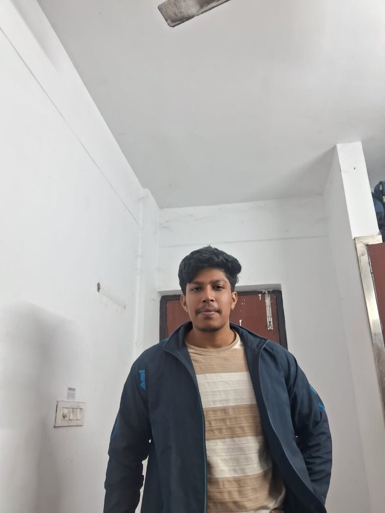

# Fieldwork – LaundryTrack

## 1. Problem Observed

Students often do not know exactly when their laundry will be ready for collection. Because of this, they may visit the laundry counter multiple times, only to discover that their clothes are still being processed. Sometimes, students may also visit when the shop is closed.

This results in wasted time, unnecessary travel, and inconvenience.

LaundryTrack aims to solve this problem by providing students with an estimated laundry-ready date and information about the shop's opening and closing days.

---

## 2. People Interviewed

| Name | Role | Student ID | Token ID |
|---|---|---|---|
| Amar | Student / Laundry Customer | S001 | LT1001 |
| Amit | Student / Laundry Customer | S002 | LT1002 |

---

# 3. Interview 1 – Amar

**Student Name:** Amar  
**Student ID:** S001  
**Token ID:** LT1001  
**Interview Timestamp:** 4:30 PM  
**Date of laundry submission:** 20 October 2026  
**Expected collection date:** 23 October 2026  
**Actual ready date:** 23 October 2026  
**Actual collection date:** 24 October 2026  

### Conversation and Answers

**Q1. On which date did you submit your clothes?**

Answer: I submitted my clothes on 20 October 2026.

**Q2. What collection date did the shop initially tell you?**

Answer: The shop told me that my clothes would be ready for collection by 23 October 2026.

**Q3. On which date were your clothes actually ready?**

Answer: My clothes were ready on 23 October 2026, which was the expected date.

**Q4. On which date did you finally collect your clothes?**

Answer: I collected my clothes on 24 October 2026, the next day after they were ready.

**Q5. How many times did you visit the counter before collecting your clothes?**

Answer: I visited the laundry counter twice before completing the collection.

**Q6. Did you ever visit when your clothes were not ready? What happened?**

Answer: Yes. According to my record, I made a visit when my clothes were not ready. I had to return again to collect them.

**Q7. Did you ever visit on a day when the shop was closed?**

Answer: No. I did not encounter a shop closure during my collection attempts.

**Q8. Did the shop's opening days affect when you could collect your clothes?**

Answer: There is no recorded information showing that the shop's opening days affected my collection. However, knowing the shop's working days in advance would make planning easier.

**Q9. What was the most inconvenient part of collecting your laundry?**

Answer: The main inconvenience was having to visit the counter more than once, even though my clothes were ready on the expected date.

**Q10. Would knowing an estimated ready date and the shop's opening days help you avoid unnecessary visits?**

Answer: Yes. Knowing when my clothes are expected to be ready and which days the shop is open would help me plan my visit and avoid unnecessary trips.

### Conversation Summary

Amar submitted his clothes on 20 October 2026 and was informed that they would be ready by 23 October. His clothes were actually ready on the expected date, so there was no processing delay.

However, he still needed two counter visits and finally collected his clothes on 24 October. The dataset also indicates that at least one visit took place when the clothes were not ready.

This shows that even when the laundry shop completes the work on time, students may still make unnecessary visits because they do not have accurate information about the readiness of their clothes.

### Key Problem Identified

The main issue in Amar's case was the lack of timely information about laundry readiness, rather than a delay in processing.

### Suggested Solution Through LaundryTrack

LaundryTrack could display:
- Expected laundry-ready date.
- Current estimated collection date.
- Shop opening and closing days.
- A reminder to visit after the expected ready date.

---

# 4. Interview 2 – Amit

**Student Name:** Amit  
**Student ID:** S002  
**Token ID:** LT1002  
**Interview Timestamp:** 5:45 PM  
**Date of laundry submission:** 20 October 2026  
**Expected collection date:** 24 October 2026  
**Actual ready date:** 25 October 2026  
**Actual collection date:** 25 October 2026  

### Conversation and Answers

**Q1. On which date did you submit your clothes?**

Answer: I submitted my clothes on 20 October 2026.

**Q2. What collection date did the shop initially tell you?**

Answer: The shop initially informed me that my clothes would be ready by 24 October 2026.

**Q3. On which date were your clothes actually ready?**

Answer: My clothes were actually ready on 25 October 2026, which was one day later than the expected date.

**Q4. On which date did you finally collect your clothes?**

Answer: I collected my clothes on 25 October 2026, the same day they became ready.

**Q5. How many times did you visit the counter before collecting your clothes?**

Answer: I visited the counter three times before finally collecting my clothes.

**Q6. Did you ever visit when your clothes were not ready? What happened?**

Answer: Yes. The dataset indicates that I visited at least once when my clothes were not ready. Since the processing took one additional day, I had to make another visit before collecting them.

**Q7. Did you ever visit on a day when the shop was closed?**

Answer: No. According to my record, I did not encounter a shop closure during my collection attempts.

**Q8. Did the shop's opening days affect when you could collect your clothes?**

Answer: There is no recorded evidence that the shop's opening days affected my collection. However, knowing the shop's working schedule would help me plan my visits.

**Q9. What was the most inconvenient part of collecting your laundry?**

Answer: The biggest inconvenience was making multiple trips to the laundry counter because the clothes were not ready when initially expected.

**Q10. Would knowing an estimated ready date and the shop's opening days help you avoid unnecessary visits?**

Answer: Yes. If I could check the expected ready date and shop timings beforehand, I could avoid visiting the counter when my clothes were still being processed.

### Conversation Summary

Amit submitted his clothes on 20 October 2026 and was initially informed that they would be ready by 24 October. However, the processing took one additional day, and the clothes were ready on 25 October.

He finally collected his clothes on the same day they became ready, but the dataset records three counter visits. At least one visit happened when the clothes were not ready.

His case highlights an additional problem: sometimes the actual processing time is longer than the initially estimated time. Without updated information, students may waste time visiting the laundry counter repeatedly.

### Key Problem Identified

The main issue in Amit's case was the one-day processing delay combined with a lack of updated information about the readiness of his clothes.

### Suggested Solution Through LaundryTrack

LaundryTrack could provide:
- An estimated collection date.
- Updated estimated dates when processing is delayed.
- Laundry status information.
- Shop opening and closing days.
- Notifications when clothes are expected to be ready.

---

# 5. Surprising Discovery

After analysing all 20 records in the sample dataset, several interesting findings emerged.

| Observation | Result |
|---|---:|
| Orders ready on expected date | 11 out of 20 |
| Orders ready one day late | 9 out of 20 |
| Orders ready earlier than expected | 0 |
| Students who collected on their first visit | 4 |
| Total counter visits | 39 |
| Average counter visits per order | 1.95 |
| Students who encountered shop closure | 3 |

### Important Findings

1. **Even on-time laundry causes unnecessary visits:** 7 out of 11 students whose clothes were ready on the expected date still needed two visits.

2. **Processing delays increase inconvenience:** All 9 delayed orders involved at least one visit when clothes were not ready.

3. **Students do not always collect immediately:** Some students collect their clothes after the actual ready date, even when processing is completed on time.

4. **Shop closures create additional difficulties:** Three students encountered a closed shop during an attempted visit.

### Major Takeaway

The surprising discovery is that the problem is not limited to delayed laundry processing.

Even when clothes are ready on time, students may still need multiple visits because they do not know exactly when their clothes are ready.

Therefore, students need two important pieces of information:

- When their clothes are expected to be ready.
- On which days and at what times the laundry shop is open.

This supports the need for LaundryTrack.

---

# 6. Observation Record

**Location:** [Hostel]  
**Date:** [Actual observation date]  
**Start Time:** [4:00pm]  
**End Time:** [6:00pm]  
**Total Duration:** 2 hr.

### Things to Observe

1. How students submit their clothes and receive tokens or receipts.
2. Whether the laundry shop maintains a register of submitted clothes.
3. How students check whether their clothes are ready.
4. Whether the shop displays its opening and closing days.
5. Whether students have to ask staff repeatedly about laundry status.
6. Whether students visit and are told to return later.
7. Approximately how many students visit the counter during the observation period.

---

# 7. Photos

**Photo 1:** Fieldwork Interview 1 – Amar (Student ID: S001, Hostel)  
**Timestamp:** 4:30 PM  

**Photo 2:** Fieldwork Interview 2 – Amit (Student ID: S002, Hostel)  
**Timestamp:** 5:45 PM  

---

# 8. Dataset Summary

The sample dataset contains 20 student laundry records (S001–S020), with token IDs LT1001–LT1020.

| Metric | Value |
|---|---:|
| Total student records | 20 |
| Ready on expected date | 11 |
| Ready one day late | 9 |
| Ready early | 0 |
| First-visit collections | 4 |
| Total counter visits | 39 |
| Average visits per order | 1.95 |
| Shop closure encounters | 3 |

### Data Limitations

- Exact visit dates are not available.
- The weekly closing days of the shop are not recorded.
- Actual conversations and student quotes have not been verified.
- The dataset is sample data and should not be represented as genuine field-collected data without verification.

---

# 9. How Fieldwork Supports LaundryTrack

The fieldwork identifies several problems that LaundryTrack aims to address.

| Identified Problem | LaundryTrack Feature |
|---|---|
| Students do not know when clothes will be ready | Estimated ready date |
| Actual processing may take longer | Updated estimated collection date |
| Students make repeated counter visits | Laundry status information |
| Students visit when the shop is closed | Shop opening-day information |
| Students waste time checking manually | Convenient status checking |

### Final Conclusion

After analysing the sample records of Amar and Amit and the overall dataset, it is clear that uncertainty about laundry readiness can lead to unnecessary visits and wasted time.

Amar's clothes were ready on the expected date, but he still required two visits. Amit experienced a one-day processing delay and required three visits.

These examples demonstrate two different situations that create inconvenience for students.

LaundryTrack aims to make the laundry collection process easier by providing estimated ready dates, updated status information, and shop opening schedules.

The goal is to reduce unnecessary visits, save students' time, and improve their overall laundry collection experience.